# Схема workflow проекта

> Зеркало канона `.agents/rules/workflow_scheme.md` для Codex; собирает `python scripts/sync_harness_mirrors.py`,
> вручную не правь — правка делается в каноне.

> Источник для: обзорной схемы процесса и таблицы гейтов владельца. Правила, которые схема
> показывает, здесь не пересказываются — они в файлах-источниках (список в конце).
> Версия: 2026-11-12.

Сквозной процесс: агенты, документация, гейты с участием владельца, коммиты, деплой
(если ведётся).

```mermaid
flowchart TD
    subgraph ANALYSIS["1. Аналитика — агент analyst (фазы BABOK: python phase.py)"]
        A1["input/: интервью, модели, скрины"] --> A2["Главы 3-6: планирование, выявление, стратегия. Слой 1: output/reports/<project_id>/"]
        A2 --> A3["Глава 7.1: спеки FR / UC / NFR / BR в output/data/<project_id>/specs/ + граф 5.1 (draft)"]
        A3 -->|"первый baseline"| A5
        A3 -->|"дельта к утверждённому baseline"| A4["Глава 5.4: Change Request CR-NNN"]
        A4 --> G1{"ГЕЙТ 1 - владелец: решение по CR"}
        G1 -->|"approved"| A5["Глава 5.5: пакет утверждения (baseline; при новой функции - новая версия)"]
        A5 --> G2{"ГЕЙТ 2 - владелец: приёмка пакета 5.5"}
    end

    G2 -->|"шаг «синхронизировать product_docs»"| SYNC["Sync слоя 2 (только аналитик): карточка BF-NN в planned с разделом «Планируемое изменение», INDEX.md, check_product_docs.py без ошибок"]

    SYNC --> TRACK[("Трекер: эпик BF-NN; сигнал «аналитика по BF-NN завершена»")]
    TRACK --> GATE{"ВОРОТА Arch: карточка planned + 5.5 approved + сигнал в трекере"}
    GATE -->|"не пройдены"| GATEBACK["Arch называет причину, задача возвращается аналитику"]
    GATE -->|"пройдены"| ARCH["2. Агент arch: архитектура, ADR, целевые страницы компонентов, блок «Архитектурное решение»; создаёт все задачи UX / Dev / QA / DevOps в эпике"]

    ARCH --> INDEV["Сигнал Arch «разработка BF-NN начата» → аналитик ставит карточке in_dev"]
    ARCH -->|"задачи с изменением UI"| UXPH["3. Агент ux: 2-3 варианта, design/<задача>/"]
    UXPH --> G3{"ГЕЙТ 3 - владелец: апрув decision.md"}
    G3 -->|"approved: UI-задачи Dev открыты"| D1
    ARCH -->|"серверные и инфраструктурные задачи"| D1

    subgraph DEVPH["4. Разработка — агент dev"]
        D1["Ворота Dev проверены → In Progress"] --> D2["Ветка задачи; коммит с типом и номером задачи; push"]
        D2 --> CG{"CI проекта: lint + tests + secrets"}
        CG -->|"green"| D3["Локальный гейт пройден, описание задачи обновлено"]
    end

    D3 --> IR[("In Review")]
    IR --> QA["5. Агент qa: приёмка против критериев, decision.md и спеки; отчёт в qa/"]
    QA --> G4{"Pass?"}
    G4 -->|"замечания"| BUG["Задача возвращается в In Progress; дефекты вне критериев - задачи bug"]
    BUG --> D2
    G4 -->|"Pass, поведение не менялось"| DONE
    G4 -->|"Pass, менялось поведение / контракт / модель"| FACT["6. Аналитик приводит страницы к факту, check_product_docs.py = 0"]
    FACT --> DONE[("Done в трекере")]

    DONE --> DEP["7. По просьбе владельца: merge в основную ветку"]
    subgraph DEPLOY["8. Деплой — агент devops, по настройкам проекта (если ведётся)"]
        DEP --> SH["deploy-скрипт: проверки -> сборка -> доставка; миграции (с дампом БД), build/up, ожидание /health, автооткат при сбое"]
        SH -->|"красно"| RB["Автооткат на предыдущую версию, владелец уведомлён"]
        SH -->|"зелено"| LIVE["DEPLOYED_VERSION, адрес продукта"]
    end

    LIVE --> G5{"ГЕЙТ 4 - владелец: приёмка в браузере; учётные данные вводит сам, агент их не использует"}
    G5 -->|"принято"| EPILOG["Аналитик: BF-NN в implemented; дельта замечаний - через CR 5.4 / задачу"]
```

## Гейты с участием владельца

| № | Гейт | Готовит | Артефакт решения |
|---|---|---|---|
| 1 | Решение по CR (5.4) — весь скоуп/срок; при первом baseline гейта нет | analyst | `output/reports/<project_id>/5_4_cr_decision_CR-NNN_*` (Approved) |
| 2 | Приёмка пакета утверждения (5.5) | analyst | `5_5_approval_package_APKG-*_*.md` |
| 3 | Апрув дизайна UI | ux | `design/<задача>/decision.md` → `approved` |
| 4 | Приёмка релиза после деплоя (браузер: вход, бизнес-функции) | devops делает deploy, проверяет владелец | комментарий в задаче/чате |
| — | Особые: OpenSpec — только по подтверждению; merge в основную ветку и деплой; смена меток/приоритета; удаление данных (депрекация вместо удаления); учётные данные — только сам владелец | — | — |

Отдельных апрувов владельца на Done по задаче нет: задачу закрывает QA после Pass, а владелец
принимает релиз на Гейте 4. Кто и когда переносит задачу — `tasktracker.md`.

### Что создаётся на Гейте 2 (разграничение)

На **Гейте 2** (пакет 5.5 принят) создаются только: **BF-карточка** (`planned`, раздел
«Планируемое изменение»), **эпик в трекере** («BF-NN: <название>») и **baseline 5.5**.
Целевые страницы **системных компонентов** (`02_system_components/`), **архитектура**
(`architecture/`, ADR) и **задачи ролей** в эпике создаются на этапе **Arch — после Гейта 2**
(по сигналу «аналитика по BF-NN завершена»), не вместе с Гейтом 2.

## Где полные правила

| Тема | Файл |
|---|---|
| Цикл задачи, колонки, Done, названия задач, эпики | `tasktracker.md` |
| Роли, области записи, ворота Arch / Dev / QA, коммиты, миграции, `in_dev` | `dev_team.md` |
| UI-цикл, ворота Dev для UI, приёмка UI | `ui_workflow.md` |
| Плоскости документации, статусы БФ, DoD слоя 2 | `product_docs.md`, `product_docs/README.md` |
| Агенты, диспетчеризация, правило старшинства | `agent_orchestration.md` |
| Фазы BABOK (какой набор MCP активен) | `python phase.py` — после смены фазы перезапуск сессии |
